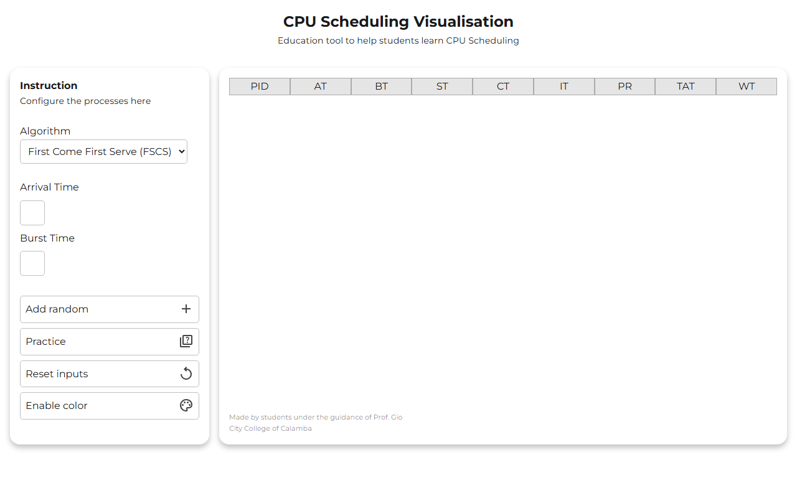

# CPU Scheduling Visualiser

A learning tool for CPU scheduling. Enter your processes, pick an algorithm, and see the schedule and every process's times. Made with classmates at City College of Calamba, under the guidance of Prof. Gio.

**[Try it live](https://cpu-scheduling-visualiser.vercel.app)**

## Features

- Four algorithms: First Come First Serve, Shortest Job First, Priority (non-preemptive) and Round Robin with a time quantum.
- Enter each process's arrival time, burst time and priority, or add random processes.
- A results table with start, completion, turnaround and waiting times.
- Practice mode: fill in the table yourself, then check your score.
- Optional color coding for each process.

## Run locally

Open `index.html` in a browser. There's no build step.

## Built with

JavaScript, HTML and CSS.
